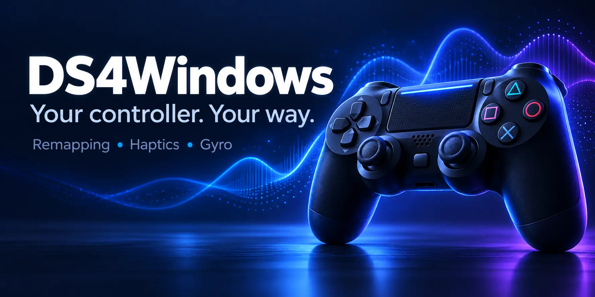

# DS4Windows 5

Controller remapping, advanced feedback, and per-game profiles for Windows.

[**Download**](https://github.com/hbashton/DS4Windows/releases) · [Documentation](docs/README.md) · [Changelog](CHANGELOG.md) · [Community](https://www.reddit.com/r/DS4Windows/)

DS4Windows builds on the work of its maintainers, earlier projects and the controller community.

## Features

- Remap buttons, sticks, touchpad, keyboard, mouse, macros, and special actions.
- Accept supported Moonlight/Sunshine virtual controllers, with an optional direct bridge for a matching Sunshine backend.
- Save per-game profiles and switch them automatically by application or window title.
- Configure gyro aiming, lighting, rumble, audio haptics, and adaptive triggers.
- Receive native DualSense advanced haptics and adaptive-trigger feedback in supported games, including over Bluetooth.

Supported inputs include DualShock 3/4, DualSense/Edge, Switch Pro, Joy-Con,
Switch 2 Pro, and Joy-Con 2. Outputs include Xbox 360, Xbox One/Series,
DualShock 4, DualSense/Edge, and Switch 2 Pro. Features depend on the
controller, connection, and game.

## Get started

1. Download the **x64 Setup EXE** from [Releases](https://github.com/hbashton/DS4Windows/releases).
2. Follow setup to install the bundled VIIPER backend and USB/IP driver. HidHide helps prevent double input; restart if prompted.
3. Connect your controller and choose a profile and emulated controller. Avoid overlapping Steam Input remapping for the same game.

**Requirements:** Windows 10 or 11 x64 and the [Visual C++ x64 runtime](https://aka.ms/vs/17/release/vc_redist.x64.exe). The .NET runtime is included.

For portable use, extract the entire `DS4Windows_<version>_x64.zip`, keeping the
`Lang` folder with the app. See [Documentation](docs/README.md) for
setup, update instructions, and troubleshooting. Read the release notes for
signing status and known limitations.

## Project links

[Support development](https://www.paypal.com/paypalme/hbashton) · [Report a bug](https://github.com/hbashton/DS4Windows/issues) · [Contribute](contributing.md) · [VIIPER backend](https://github.com/hbashton/VIIPER) · [DS4Updater](https://github.com/hbashton/DS4Updater)

Use the matching backend bundled with DS4Windows. The updater is optional
when downloading and installing updates manually.

Thanks to hbashton, Jays2Kings, Ryochan7, Schmaldeo, the DS4Windows community,
and the contributors to VIIPER, HidHide, usbip-win2, and controller research.

Licensed under [GPL-3.0](COPYING). See [third-party notices](NOTICE.txt).
