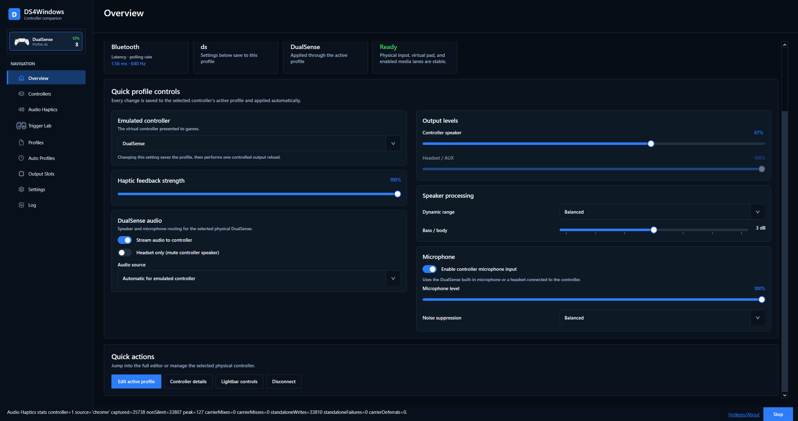

# DS4Windows documentation

For the current Windows x64 app. Start with the user guides; implementation
contracts and dated validation records are intended for contributors.

## Explore the app

The [illustrated user guide](user-guide.md) walks through
[controllers](user-guide.md#controllers), [profiles and remapping](user-guide.md#profiles),
[Audio Haptics](user-guide.md#audio-haptics), [Trigger Lab](user-guide.md#trigger-lab),
[Auto Profiles](user-guide.md#auto-profiles), [Output Slots](user-guide.md#output-slots)
and [Settings](user-guide.md#settings). Screenshots sit beside the controls they explain.

## Use DS4Windows

| Guide | What it covers |
| --- | --- |
| [Getting started](getting-started.md) | Requirements, installation, portable setup, updates and profiles |
| [User guide](user-guide.md) | Controllers, profile editing, auto profiles, output slots, settings and logs |
| [Troubleshooting](troubleshooting.md) | Detection, double input, backend startup, feedback and updates |
| [Swipe profiles](swipe-profiles.md) | Restrict two-finger profile switching |
| [Moonlight / Sunshine](moonlight-support.md) | Accept supported streamed virtual controllers |
| [Flick stick](flick-stick-calibration.md) | Calibration and troubleshooting |
| [Mouse clicks](troubleshooting-mouse-clicks.md) | Diagnosing simultaneous mouse-button mappings |
| [DSX game mods](DSX-game-mod-support.md) | Optional mod integration and its limits |
| [DualSense Bluetooth audio](dualsense-bluetooth-audio-haptics.md) | Audio and haptics transport details |

## Contribute and maintain

- [Contributing](../contributing.md): reporting bugs, proposing changes and documentation rules.
- [Development](development.md): build, tests, packaging and code layout.
- [Roadmap](roadmap.md): priorities and proposals, rather than a completed-task list.
- [Release workflow](../.github/workflows/release.yml): upstream build, signing and publication requirements.
- [Installer](../installer/README.md) and [installer validation](INSTALLER_VALIDATION_STRATEGY.md).
- [Translations](dev/translations.md) and [profile schema reference](dev/profile-schema-reference.md).
- [Technical reference](reference.md): runtime contracts and diagnostic tools.
- [Validation archive](validation/README.md): dated tests and investigations.

Release history belongs in [CHANGELOG.md](../CHANGELOG.md). Keep one canonical
page per topic, and link directly to it. A dated investigation describes its
recorded source and hardware; it does not establish the status of a newer build.
