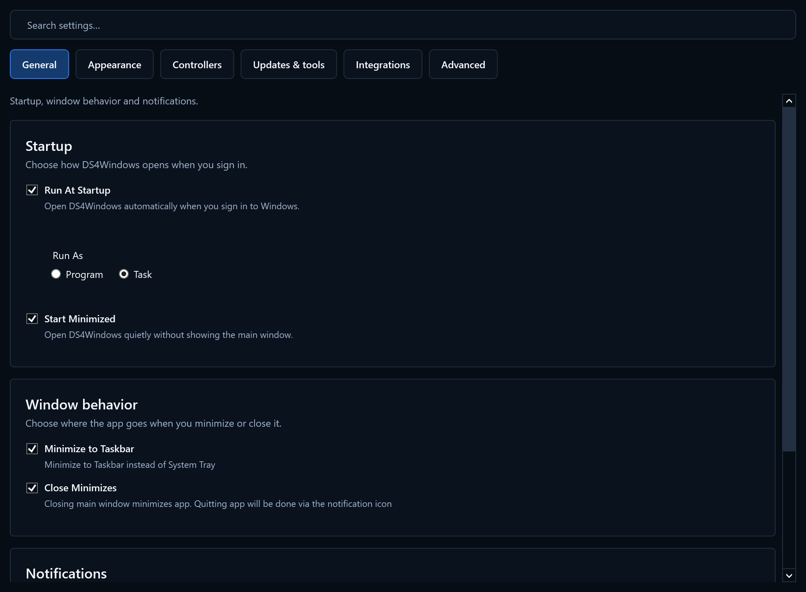

# Settings navigation

Settings uses the available window width and groups options into General,
Appearance, Controllers, Updates & tools, Integrations and Advanced.
Search finds groups across sections without resetting edited values; Ctrl+F
focuses search, and Clear or Escape while typing restores the selected section.
The last selected section is remembered on normal shutdown.

Language changes show a restart reminder. Custom executable changes show the
filename to use on re-launch. Theme, tray icon and priority apply immediately.
Use Copy Text or Export on the Log page to share startup diagnostics, including
installed/portable mode and USB/IP/driver status. The illustrated preferences
may differ from your saved values. Optional Nintendo controls remain accessible.
